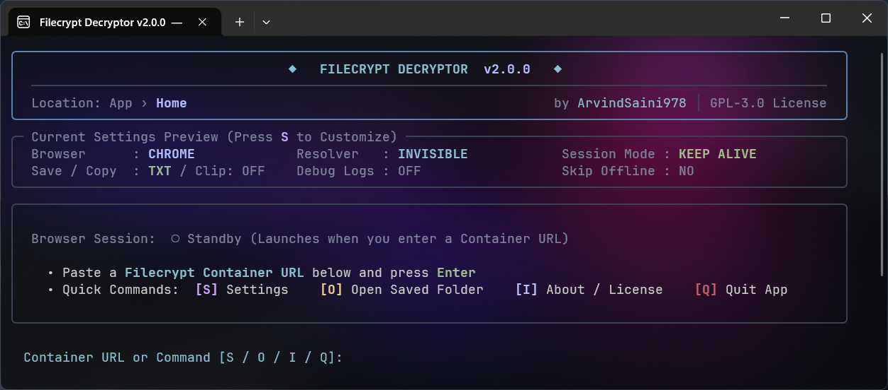
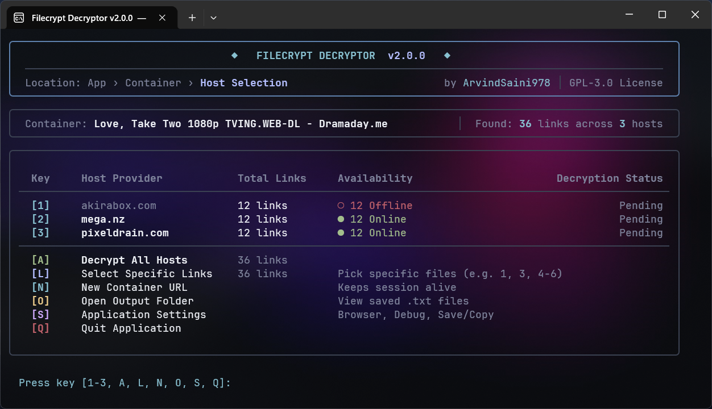
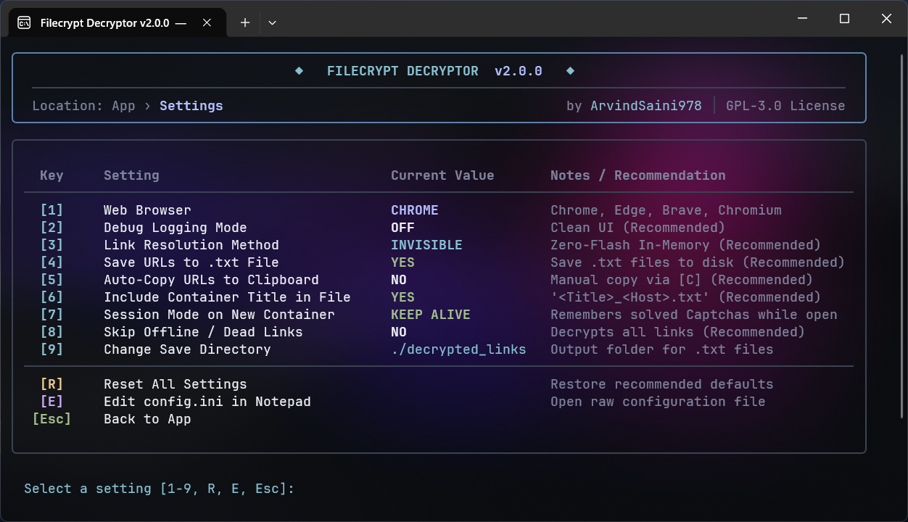

<div align="center">
  
  <h1>Filecrypt Decryptor v2.0.0</h1>
  <p>A high-performance, zero-overhead link decrypter and resolver for Filecrypt containers with a modern TrueColor TUI, ad/popup blocking, session persistence, selective link extraction, and multi-host batch decryption.</p>
  <p>
    <a href="https://github.com/ArvindSaini978/Filecrypt-Decryptor/releases/latest"><b>⬇ Download Standalone .EXE (v2.0.0)</b></a>
    &nbsp;•&nbsp;
    <a href="https://github.com/ArvindSaini978/Filecrypt-Decryptor/blob/master/filecrypt_decryptor.go"><b>View Source Code</b></a>
    &nbsp;•&nbsp;
    <a href="https://github.com/ArvindSaini978/Filecrypt-Decryptor/blob/master/LICENSE"><b>GPL-3.0 License</b></a>
    &nbsp;•&nbsp;
    <a href="https://github.com/ArvindSaini978/Filecrypt-Decryptor/issues"><b>Report Issue</b></a>
  </p>
</div>

## 📸 Screenshots

<div align="center">
  
  <hr/>
  
  <hr/>
  
</div>

---

## ⚡ Highlights & Architecture (Go Native Engine)

- **🚀 Pure Standalone Native Binary (~11.5 MB):** Compiled to a single, self-contained native Windows executable (uncompressed, zero UPX packing) that launches in **0.02s** with zero temporary folder (`%TEMP%`) unpacking.
- **🛡️ Zero External Runtime Dependencies:** Talks directly to your installed browser (Google Chrome, Microsoft Edge, Brave, or Chromium) via native Chrome DevTools Protocol (CDP) — no external Python runtime or Node.js drivers required.
- **🎯 Selective Individual Link Decryption (`[L]`):** Browse all container links in a paginated view (25 links/page) and extract specific files or ranges (e.g., `1`, `1, 3, 5`, `2-6`, or `A`) with episode-aware filename display (`S01E04`, `Part.2`) and session-level link caching.
- **💾 Flexible Output Modes (`.txt` File & Clipboard):** Save decrypted links as clean `.txt` files per host, or disable disk saving (`Save URLs to .txt File: NO`) for a pure console + clipboard workflow.
- **🔄 Connection-Pooled In-Memory Resolver:** Reuses open sockets for in-memory `/Link/` ➔ `/Go/` redirect extraction, achieving ~30–50ms decryption speeds per link.
- **⏹️ Instant Operation Cancellation (`[Esc]` / `[X]`):** Abort container loading, Captcha waiting, or link decryption at any time and return immediately without restarting the app.
- **📁 Clean `%APPDATA%` Storage:** Stores `config.ini` and `browser_profile` cleanly inside `%APPDATA%\FilecryptDecryptor` so running the `.exe` from your Desktop or Downloads never litters profile folders next to the binary.

> *Note: The original Python implementation is archived in the [`legacy-python`](https://github.com/ArvindSaini978/Filecrypt-Decryptor/tree/legacy-python) branch.*

---

## ✨ Key Features

- **⚡ Zero-Flash In-Memory Link Resolver:** Follows Filecrypt `/Link/` ➔ `/Go/` redirect chains directly in memory with **zero screen flashing**, with an automatic single-tab dark fallback for client-side hash hosts like `mega.nz`.
- **🛡️ Multi-Layer Ad & Popup Blocker:** Automatically strips Filecrypt/CutCaptcha ad overlays, shadow-DOM click-jackers, and hijacked popup tabs at the protocol layer.
- **🔑 Captcha Session Persistence (`KEEP ALIVE`):** Keeps the browser session alive across multiple containers (`[N]`) so solved Captchas (`PHPSESSID`) stay remembered while the browser remains open.
- **📊 Smart Host Selection & Availability Detection:** Groups container links by host provider (`mega.nz`, `pixeldrain.com`, `1fichier.com`, etc.), detects online/offline status, heals false-offline status glitches, and tracks `Partial (x/y)` vs `Decrypted (y/y)` progress.
- **📋 Persistent Link Viewer & Quick Copy:** Displays extracted links right inside the terminal after decryption with one-key `[C]` clipboard copy and optional automatic clipboard copying.
- **⚙️ Interactive Settings & Self-Healing Config:** Customize your browser, resolve mode, `.txt` file saving, auto-copy, session persistence, and output folder directly inside the app with an automatic `config.ini` validator.

---

## 🚀 Quick Start

### Option 1: Standalone Windows Executable (Recommended)
1. Go to the [**Releases Page**](https://github.com/ArvindSaini978/Filecrypt-Decryptor/releases/latest) and download **`FilecryptDecryptor-v2.0.0-x64.exe`** (or `-arm64.exe` / `-x86.exe` for your system).
2. Double-click the `.exe` to launch the app.
3. Paste any Filecrypt Container URL and press **Enter**!
> **Note:** Works out-of-the-box with **Google Chrome**, **Microsoft Edge**, **Brave Browser**, or **Chromium** installed on your PC. Press **`[S]` (Settings)** inside the app to switch browsers anytime.

### Option 2: Run from Source Code
```powershell
git clone https://github.com/ArvindSaini978/Filecrypt-Decryptor.git
cd Filecrypt-Decryptor
go run filecrypt_decryptor.go
```

---

## ⌨️ In-App Controls & Shortcuts

| Key | Action | Description |
| :---: | :--- | :--- |
| **`[1-9]`** | **Decrypt Selected Host** | Extracts download links for a specific host provider |
| **`[A]`** | **Decrypt All Hosts** | Batch-extracts links across every available host in the container |
| **`[L]`** | **Select Specific Links** | Browse all files (paginated) and decrypt specific links or ranges (e.g., `1, 3, 4-6`) |
| **`[C]`** | **Copy Shown URLs** | Copies the most recently decrypted URLs directly to Windows Clipboard |
| **`[N]`** | **New Container URL** | Loads another Filecrypt container while keeping your solved Captcha session alive |
| **`[O]`** | **Open Output Folder** | Opens `./decrypted_links` in Windows Explorer to view saved `.txt` files |
| **`[S]`** | **Application Settings** | Customize Browser, Resolve Mode, Save to `.txt`, Auto-Copy, Session Mode, and Debug Logs |
| **`[I]`** | **About & License** | View author info, GitHub repository link, and GPL-3.0 license details |
| **`[Esc]` / `[X]`** | **Cancel Operation** | Cancels container loading, Captcha waiting, or active decryption at any time |
| **`[Q]`** | **Quit Application** | Cleanly closes the browser session and exits |

---

## 🛠️ Building the Standalone `.exe` Yourself

Ensure you have **Go 1.22+** installed:

**1. Download Dependencies:**
```powershell
go mod tidy
```

**2. Embed Windows Icon & Metadata (`.syso`):**
```powershell
go install github.com/tc-hib/go-winres@latest
& "$env:USERPROFILE\go\bin\go-winres.exe" make --arch amd64
```
> **Architecture Note:** Use `--arch amd64` for standard 64-bit Windows (Intel/AMD), `--arch arm64` for Windows on ARM, `--arch 386` for 32-bit Windows, or `--arch amd64,386,arm64` to generate `.syso` resources for all architectures.

**3. Compile Standalone Executable:**
```powershell
$env:CGO_ENABLED = "0"
$env:GOOS = "windows"
$env:GOARCH = "amd64"
go build -trimpath -ldflags="-w" -o dist\FilecryptDecryptor-v2.0.0-x64.exe
Remove-Item -Force rsrc_windows_*.syso -ErrorAction SilentlyContinue
```

---

## 📜 License

Copyright © 2026 **[ArvindSaini978](https://github.com/ArvindSaini978)**.  
This program is free software licensed under the **[GNU General Public License v3.0 (GPL-3.0)](https://github.com/ArvindSaini978/Filecrypt-Decryptor/blob/master/LICENSE)**.