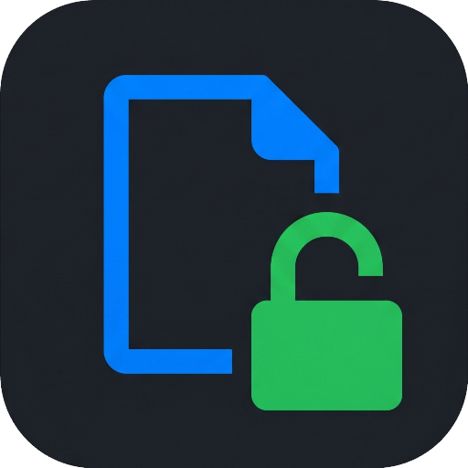

<div align="center">
  
  <h1>Filecrypt Decryptor v2.0.0</h1>
  <p>A high-performance, zero-overhead link decrypter and resolver for Filecrypt containers with a modern TrueColor TUI, ad/popup blocking, session persistence, and multi-host batch extraction.</p>
  <p>
    <a href="https://github.com/ArvindSaini978/Filecrypt-Decryptor/releases/latest"><b>⬇ Download Standalone .EXE (v2.0.0)</b></a>
    &nbsp;•&nbsp;
    <a href="https://github.com/ArvindSaini978/Filecrypt-Decryptor/blob/master/filecrypt_decryptor.go"><b>View Go Source</b></a>
    &nbsp;•&nbsp;
    <a href="https://github.com/ArvindSaini978/Filecrypt-Decryptor/blob/master/LICENSE"><b>GPL-3.0 License</b></a>
    &nbsp;•&nbsp;
    <a href="https://github.com/ArvindSaini978/Filecrypt-Decryptor/issues"><b>Report Issue</b></a>
  </p>
</div>

## 📸 Screenshots

<div align="center">
  
  <hr/>
  
  <hr/>
  
</div>

---

## ⚡ What's New in v2.0.0 (Go Native Engine Rewrite)

- **🚀 ~91% Smaller Binary:** Reduced from ~40+ MB down to **~3.5 MB** (UPX compressed) / **~10.5 MB** (raw binary).
- **⚡ Instant Startup:** Launches in **0.02s** with **zero disk unpacking** to temporary folders (`%TEMP%`).
- **🛡️ Pure Standalone Architecture:** Talks directly to your installed browser (Google Chrome, Microsoft Edge, Brave, or Chromium) via native Chrome DevTools Protocol (CDP) — no external Python runtime or Node.js drivers required.
- **🔄 Connection-Pooled HTTP Resolver:** Reuses open sockets for in-memory link extraction, achieving ~30–50ms decryption speeds per link.
- **🎨 Pixel-Accurate TrueColor TUI:** 24-bit TrueColor Nord / Catppuccin Mocha theme with complete box-drawing, multi-line word-wrapping, and interactive Settings.

> *Note: The legacy Python implementation has been permanently preserved in the [`legacy-python`](https://github.com/ArvindSaini978/Filecrypt-Decryptor/tree/legacy-python) branch.*

---

## ✨ Key Features

- **⚡ Zero-Flash In-Memory Link Resolver:** Follows Filecrypt `/Link/` ➔ `/Go/` redirect chains directly in memory with **zero screen flashing**, with an automatic single-tab dark fallback for client-side hash hosts like `mega.nz`.
- **🛡️ Multi-Layer Ad & Popup Blocker:** Automatically strips Filecrypt/CutCaptcha ad overlays, shadow-DOM click-jackers, and hijacked popup tabs at the protocol layer.
- **🔑 Captcha Session Persistence (`KEEP ALIVE`):** Keeps the browser session alive across multiple containers (`[N]`) so solved Captchas (`PHPSESSID`) stay remembered while the browser remains open.
- **📊 Smart Host Selection & Availability Detection:** Groups container links by host provider (`mega.nz`, `pixeldrain.com`, `1fichier.com`, etc.), detects online/offline status, heals false-offline status glitches, and saves clean `.txt` link files.
- **📋 Persistent Link Viewer & Quick Copy:** Displays extracted links right inside the terminal after decryption with one-key `[C]` clipboard copy.
- **⚙️ Interactive Settings & Self-Healing Config:** Customize browser, resolve mode, and auto-copy directly inside the app with an automatic `config.ini` validator.

---

## 🚀 Quick Start

### Option 1: Standalone Windows Executable (Recommended)
1. Go to the [**Releases Page**](https://github.com/ArvindSaini978/Filecrypt-Decryptor/releases/latest) and download **`FilecryptDecryptor.exe`**.
2. Double-click **`FilecryptDecryptor.exe`** to launch the app.
3. Paste any Filecrypt Container URL and press **Enter**!
> **Note:** Works out-of-the-box with **Google Chrome**, **Microsoft Edge**, **Brave Browser**, or **Chromium** installed on your PC. Press **`[S]` (Settings)** inside the app to switch browsers anytime.

### Option 2: Run from Go Source Code
```powershell
git clone https://github.com/ArvindSaini978/Filecrypt-Decryptor.git
cd Filecrypt-Decryptor
go run filecrypt_decryptor.go
```

---

## ⌨️ In-App Controls & Shortcuts

| Key | Action | Description |
| :---: | :--- | :--- |
| **`[1-9]`** | **Decrypt Selected Host** | Extracts and saves all download links for a specific host provider |
| **`[A]`** | **Decrypt All Hosts** | Batch-extracts links across every available host in the container |
| **`[C]`** | **Copy Shown URLs** | Copies the most recently decrypted URLs directly to Windows Clipboard |
| **`[N]`** | **New Container URL** | Loads another Filecrypt container while keeping your solved Captcha session alive |
| **`[O]`** | **Open Output Folder** | Opens `./decrypted_links` in Windows Explorer to view saved `.txt` files |
| **`[S]`** | **Application Settings** | Customize Browser, Resolve Mode, Auto-Copy, Session Persistence, and Debug Mode |
| **`[I]`** | **About & License** | View author info, GitHub repository link, and GPL-3.0 license details |
| **`[Q]`** | **Quit Application** | Cleanly closes the browser session and exits |

---

## 🛠️ Building the Standalone `.exe` Yourself

Ensure you have **Go 1.22+** installed:

**1. Download Dependencies:**
```powershell
go mod tidy
```

**2. Embed Windows Icon & Metadata (`.syso`):**
```powershell
go install github.com/tc-hib/go-winres@latest
& "$env:USERPROFILE\go\bin\go-winres.exe" make --arch amd64
```
> **Architecture Note:** Use `--arch amd64` for standard 64-bit Windows (Intel/AMD), `--arch arm64` for Windows on ARM, `--arch 386` for 32-bit Windows, or omit `--arch` to generate `.syso` resources for both 64-bit and 32-bit automatically.

**3. Compile Optimized Standalone Executable:**
```powershell
go build -trimpath -ldflags="-s -w" -o dist\FilecryptDecryptor.exe
```

---

## 📜 License

Copyright © 2026 **[ArvindSaini978](https://github.com/ArvindSaini978)**.  
This program is free software licensed under the **[GNU General Public License v3.0 (GPL-3.0)](https://github.com/ArvindSaini978/Filecrypt-Decryptor/blob/master/LICENSE)**.